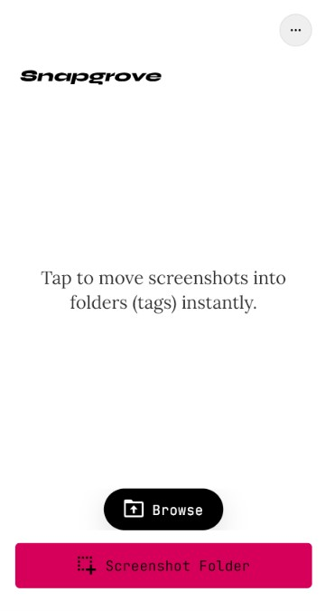

# Snapgrove Screenshots

Visual overview of Snapgrove across Desktop and Mobile platforms.

[Back to README](../../../README.md)

---

## Desktop & Web Interface

| Main Gallery | Home View | Selection Mode |
| :---: | :---: | :---: |
|  |  |  |
| Direct grid tagging and sorting. | Quick directory and folder selection. | Multi-file batch move and triage. |

---

## Mobile Interface

| Home View | Gallery Grid | Selection Mode |
| :---: | :---: | :---: |
|  |  |  |
| Storage and folder shortcuts. | Fast sliver-based scroll grid. | Multi-select with discard safety. |

---

[Back to README](../../../README.md)
