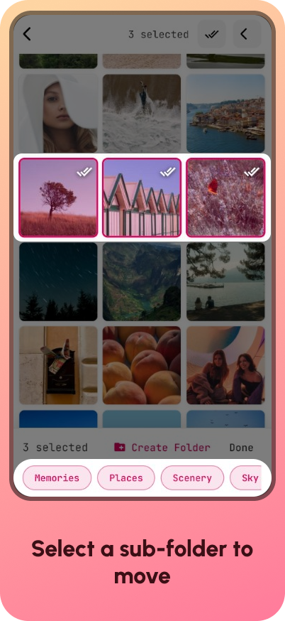
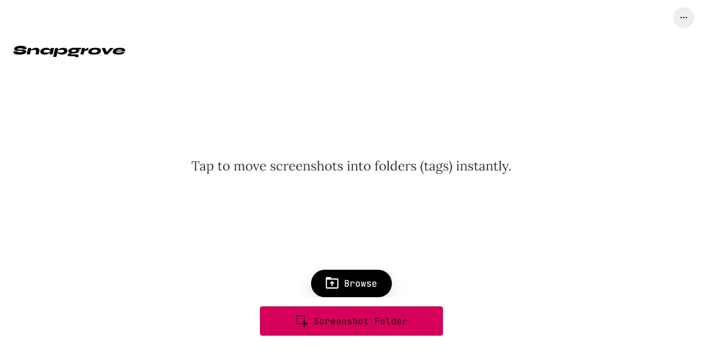
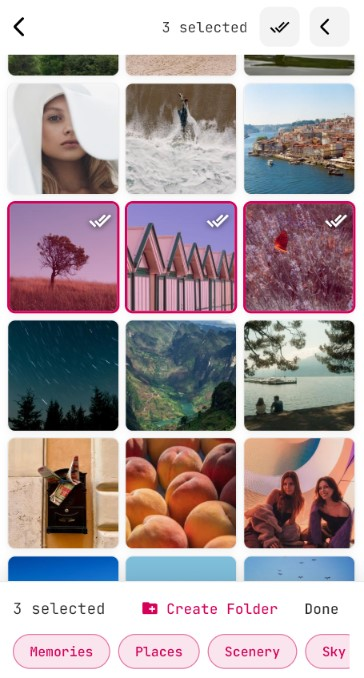

# Snapgrove Screenshots

Visual overview of Snapgrove across Desktop and Mobile platforms.

[Back to README](../../../README.md)

---

## Desktop & Web Interface

### Main Working Gallery
Organize, sort, and tag screenshots directly from a high-performance grid layout.

  

### Desktop Home View
Select screenshot directories or browse temporary folders with a single click.

  

### Desktop Selection Mode
Select single or multiple screenshots to move, organize, or batch-process into subfolders.

  

---

## Mobile Interface

### Mobile Home View
Access permanent screenshot storage or browse custom folders with responsive touch controls.

  

### Mobile Gallery Grid
Scroll smoothly through thousands of screenshots with optimized sliver rendering.

  

### Mobile Selection Mode
Batch select screenshots on touch devices with protected discard navigation.

  

---

[Back to README](../../../README.md)
